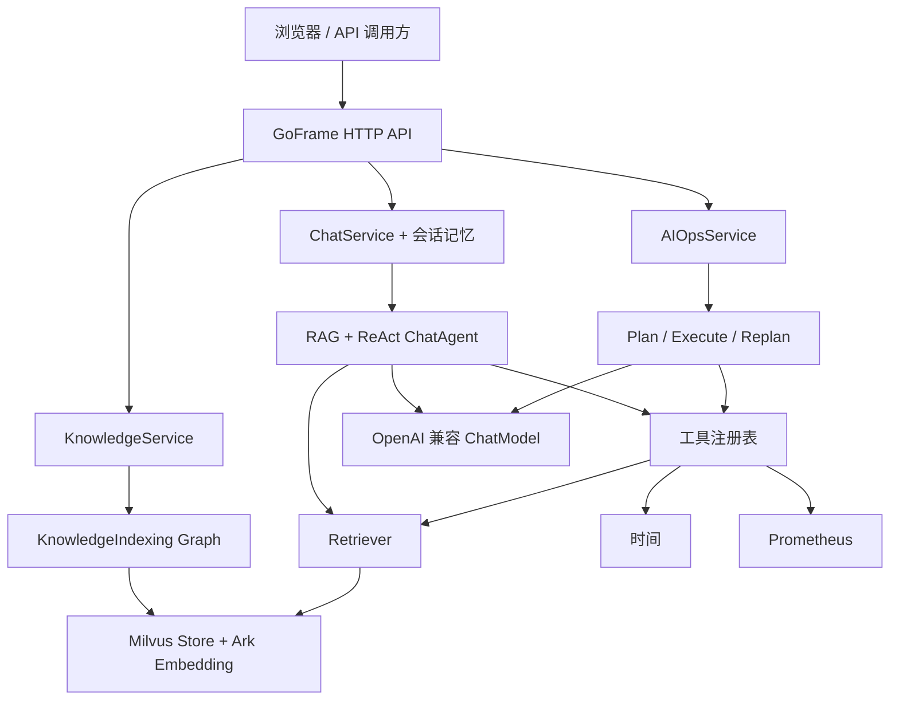

# OnCallAgent

基于 **GoFrame + Eino + Milvus** 的智能运维助手，将内部手册检索、工具调用和排查报告整合到同一个工作台。

OnCallAgent 提供带来源的知识问答、普通与流式对话，以及基于 Prometheus 告警的计划式运维分析。后端使用 Go，前端采用原生 HTML、CSS 和 JavaScript，无需前端构建流程。

[快速开始](#快速开始) · [基本使用](#基本使用) · [文档](docs/README.md) · [开发与贡献](docs/development.md)

## 核心能力

| 能力 | 说明 |
| --- | --- |
| 知识库 | 上传 UTF-8 文本或 Markdown，切分、生成向量并写入 Milvus；稳定片段 ID 支持重复入库与版本更新 |
| 知识问答 | RAG 首轮检索与 ReAct 工具调用结合，回答可引用文档来源 |
| 多轮对话 | 普通聊天与 SSE 共享会话，默认保留最近 3 轮完整对话、30 分钟过期 |
| 运维分析 | ADK Plan/Execute/Replan 编排，规划与执行模型可独立配置，输出五部分报告及步骤概要 |
| 工具扩展 | 按配置注册时间、内部文档检索和 Prometheus 告警工具，复用客户端 |
| Web 工作台 | 普通/流式聊天、停止生成、上传、新建会话、浏览器历史及独立 AI Ops 面板 |
| 可观测性 | 易读文本日志、请求关联 ID、代码位置、上游 HTTP 状态及安全错误类别 |

## 架构概览



客户端和图在启动时创建，通过构造函数注入服务；请求中不重复建立连接或编译图。独立 CLI 复用相同组件。三条编排及数据流见[架构指南](docs/architecture.md)。

## 技术栈

| 组件 | 当前版本 / 要求 |
| --- | --- |
| Go | **1.23.12**，命令使用 `GOTOOLCHAIN=local` |
| GoFrame | v2.7.1 |
| Eino / DevOps | v0.6.0 / v0.1.7 |
| ChatModel | Eino OpenAI 扩展 v0.1.1，模型须支持工具调用 |
| Embedding | Eino Ark 扩展 v0.1.2；豆包多模态接口处理文本 |
| Milvus | Go SDK v2.4.2；已有 v2.4.1 服务联调记录，其他版本需自行验证 |
| 前端 | 原生 HTML/CSS/JavaScript；开发服务器使用 Node.js 20+ |

完整 Go 依赖锁定于 [go.mod](backend/go.mod) 和 [go.sum](backend/go.sum)。浏览器 Markdown 依赖随仓库提供，版本与许可证见[第三方依赖说明](frontend/vendor/README.md)。

## 快速开始

### 1. 准备环境

需要 Go 1.23.12、Node.js 20+、可访问的 Milvus 实例，以及聊天模型和 Ark Embedding 的有效凭据。Milvus 数据库须已存在；项目提供集合初始化命令，不负责部署数据库。

```bash
git clone https://github.com/fredzsxie/OnCallAgent.git
cd OnCallAgent

# 首次创建配置；保留已有 .env
if [ ! -e backend/.env ]; then
  cp backend/.env.example backend/.env
fi
```

编辑 `backend/.env`，至少确认：

| 配置 | 填写方式 |
| --- | --- |
| `ONCALL_CHAT_MODEL_BASE_URL` | OpenAI 兼容 API 基础地址，通常以 `/v1` 结尾，不是完整聊天端点 |
| `ONCALL_CHAT_MODEL_MODEL` | 服务商实际可调用、支持工具调用的模型 ID |
| `ONCALL_CHAT_MODEL_API_KEY` | 聊天模型密钥 |
| `ARK_API_KEY` | 可访问所配置 Embedding 模型的 Ark 密钥 |
| `ONCALL_MILVUS_ADDRESS` | 你的 Milvus `host:port`，默认端口 19530 |

默认 Embedding 模型为 `doubao-embedding-vision-251215`，通过 `/embeddings/multimodal` 处理文本。Prometheus 工具默认关闭；需要告警分析时再配置并启用。

配置优先级为 **进程环境变量 > `.env` > 默认值**；显式空值不会回退。所有配置、模型继承和认证规则见[配置指南](docs/configuration.md)。不要提交实际 `.env`。

### 2. 初始化集合并启动后端

在仓库根目录执行：

```bash
cd backend
GOTOOLCHAIN=local go run ./cmd/init_knowledge
GOTOOLCHAIN=local go run .
```

初始化会调用真实 Embedding 探测维度，创建缺失集合和 HNSW/COSINE 索引并加载。已有结构不匹配时报告差异，保留数据，不自动删除或重建。

Web 默认监听 `6872`。服务启动依赖模型配置和可用的知识集合；`/api/health` 是服务存活检查，不代表所有外部依赖实时就绪。

### 3. 启动前端

另一终端，从仓库根目录执行：

```bash
cd frontend
./start.sh
```

打开 **http://127.0.0.1:8080**。开发服务将同源 `/api` 转发到 `http://127.0.0.1:6872`，无需 `npm install`。

```bash
# 在 frontend/ 中执行，自定义开发后端和前端端口
ONCALL_API_ORIGIN=http://127.0.0.1:6872 \
ONCALL_FRONTEND_PORT=8080 ./start.sh
```

静态托管及 Nginx 配置见[部署指南](docs/deployment.md)。

## 基本使用

以下命令均在仓库根目录执行，要求后端已启动。

### 普通与流式聊天

```bash
curl -sS http://127.0.0.1:6872/api/chat \
  -H 'Content-Type: application/json' \
  -d '{"Id":"demo","Question":"你好，请介绍你的能力。"}'

curl -N http://127.0.0.1:6872/api/chat_stream \
  -H 'Content-Type: application/json' \
  -d '{"Id":"demo","Question":"现在几点？"}'
```

普通成功响应为 `{"message":"OK","data":{"answer":"..."}}`。相同 `Id` 共享后端记忆；CLI 的历史由调用方显式传入。流式接口以 `done` 事件表示成功，HTTP 200 本身不代表回答成功。

### 上传后提问

```bash
curl -sS http://127.0.0.1:6872/api/upload \
  -F 'file=@backend/test/retriever/testdata/auth_runbook.md'

curl -sS http://127.0.0.1:6872/api/chat \
  -H 'Content-Type: application/json' \
  -d '{"Id":"runbook-demo","Question":"AuroraAuth 密钥轮转后出现 401，如何恢复并验证？"}'
```

示例文件描述的是虚构服务。上传支持 `.txt`、`.md`、`.markdown`，默认上限 10 MiB；文件进入共享知识库，而非某个会话的独占附件。

### 运维分析

配置并启用 Prometheus 工具后，在页面选择 **AI Ops → 开始分析**，或执行：

```bash
curl -sS --max-time 210 http://127.0.0.1:6872/api/ai_ops \
  -H 'Content-Type: application/json' -d '{}'
```

HTTP 执行固定排查任务，返回 `data.result` 报告和 `data.detail` 步骤概要。禁用或失败工具会限制证据；无告警不等于系统健康。自定义任务请使用[运维 CLI](docs/cli.md#运维分析)。

## 文档导航

| 指南 | 内容 |
| --- | --- |
| [文档索引](docs/README.md) | 按使用、集成和开发需求选择阅读路径 |
| [架构](docs/architecture.md) | 三条编排、模块职责、向量存储、生命周期及一致性边界 |
| [配置](docs/configuration.md) | 环境变量、默认值、校验、模型和工具配置 |
| [HTTP API](docs/api.md) | 五个接口、SSE 协议、响应示例和错误处理 |
| [CLI](docs/cli.md) | 模型检查、集合初始化、入库、检索、工具及 Agent 调试 |
| [部署](docs/deployment.md) | 前后端启动、同源代理、超时、持久化与访问控制 |
| [开发与测试](docs/development.md) | 本地测试、Postman 模拟、显式集成及贡献约定 |
| [日志与排障](docs/observability.md) | 请求追踪、日志字段和常见故障 |

## 功能边界

- 当前没有内置用户认证、租户隔离或权限管理。会话 `Id` 是上下文标识，不是身份凭证；对外提供服务时应配置访问控制。
- 后端记忆仅存在于当前进程，重启清空，多实例不共享；浏览器 localStorage 仅保存展示记录，不会恢复后端上下文。
- 当前工具为时间、内部文档和 Prometheus 告警；不包含日志 MCP、自动修复、异步运维任务或运维 SSE。
- 流式回答先确认模型轮次，再转发最终回答片段，不保证逐 token 的首字延迟。取消或网络失败时，客户端可能无法确认服务端是否已提交本轮。
- 日志会完整记录当前用户请求的 `Id`、`Question` 或任务查询；部署时请按实际数据要求管理日志访问和留存。
- 默认测试使用本地依赖；模型工具调用能力、外部服务可用性和完整云端分析须在目标环境验证。

## 参与贡献

欢迎通过 [Issues](https://github.com/fredzsxie/OnCallAgent/issues) 提交可复现问题和功能建议，通过 Pull Request 提交改进。开发环境、验证方式及 `type(scope): subject` 提交规范见[贡献说明](docs/development.md#参与贡献)。

仓库当前**尚未指定项目许可证**，不声明已按 MIT、Apache-2.0 或其他许可证授权。随附第三方资源保留其各自许可证。
