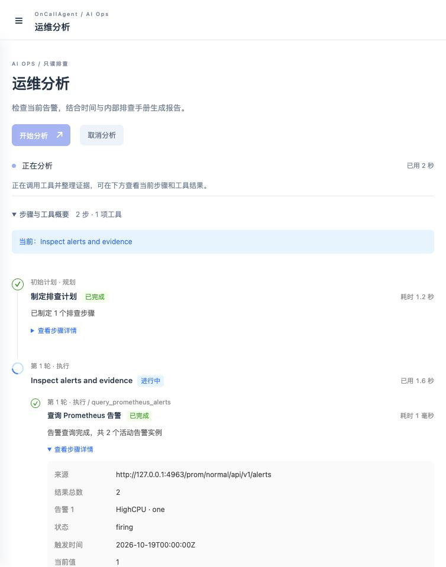
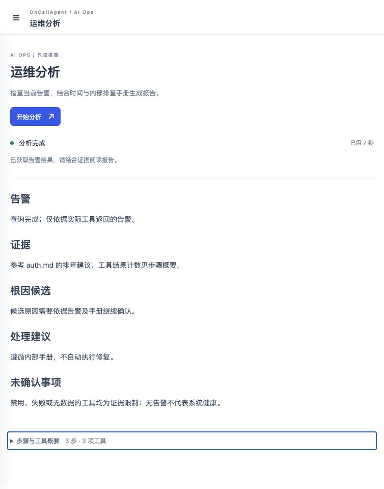

# AI Ops 实时进度验收

2026-11-16，基于 `codex/aiops-live-progress` 的实现提交 `bb76d85` 验证。使用真实 GoFrame 控制器、Plan/Execute/Replan、模型 SDK 和同源代理；模型与 Prometheus 来自仓库已有 Postman 模拟，知识目录使用临时 SQLite 与内存检索存储。未调用生产模型、Prometheus 或 Milvus。

## 结果

| 验证 | 结果 |
| --- | --- |
| Go 正式源码及测试包 | 全部通过；包含旧 JSON 接口、成对步骤、并行同名工具、深拷贝、截断、超时、心跳及断连 |
| 运维、聊天、前端服务 race | 全部通过；聊天 SSE 的写超时和 Flush 失败回归通过 |
| 正式源码与测试 vet / 正式源码 build | 通过 |
| 前端默认测试 | 30 通过，2 个显式集成入口默认跳过，0 失败 |
| 显式本地端到端测试 | 6 个场景及父测试全部通过，共 7 项；成功任务有 13 条事件、6 个逻辑步骤（含 3 项工具） |
| Postman JSON + SSE 契约 | 24 个请求、40 项断言全部通过，退出码 0；禁用结果上传 |

本机被 Git 忽略的 `backend/data/knowledge_maintenance/20261113-cleanup/` 包含两个同包 main 脚本，导致原始 `go test ./...` / vet / build 包遍历失败。未改动这些本地脚本，改用下面覆盖全部正式包和测试包的命令完成验证。最初一次并行全量执行中的 Dev 发现测试异常，在独立重跑及正式包全量重跑中均通过。

```bash
ONCALL_INTEGRATION=0 GOTOOLCHAIN=local go -C backend test \
  . ./api/... ./cmd/... ./internal/... ./utility/... ./test/...
ONCALL_INTEGRATION=0 GOTOOLCHAIN=local go -C backend test -race \
  ./test/ops ./test/chat ./test/frontend
GOTOOLCHAIN=local go -C backend vet \
  . ./api/... ./cmd/... ./internal/... ./utility/... ./test/...
GOTOOLCHAIN=local go -C backend build \
  . ./api/... ./cmd/... ./internal/... ./utility/...
ONCALL_INTEGRATION=0 node --test backend/test/frontend/*.test.mjs
```

## 浏览器观察

- 慢任务约 7.4 秒完成，报告返回前已展示规划完成、执行中状态、工具结果和递增耗时。阶段、工具各自计时，同一次调用的开始与结束合并为一行。
- 告警详情保留 HighCPU 的 one、two 两个实例及状态、标签、注释、触发时间和值。时间详情提供时区和 Unix 时间戳。
- 上传合成 SOP 后，手册工具真实命中两个片段；页面显示查询、hybrid/rrf、来源、章节、版本、评分与片段。
- 运行中展开的工具详情在后续事件与最终快照更新后保持展开；成功时外层概要折叠，原五部分报告优先展示，重新展开仍保留内层状态。
- 空告警提示“无告警不代表系统健康”；认证失败显示中文原因与 authentication_failed，仍能生成证据受限报告。
- 模型失败和超时不展示成功报告，已收到的步骤保留并展开；取消立即恢复控件，之后的新任务成功完成。
- 恶意标记场景在报告 DOM 中没有 script、img、iframe、事件属性或 javascript 链接；步骤详情始终以纯文本构建。
- 390×844 视口下，运维容器 scrollWidth 与 clientWidth 均为 390；键盘 Enter 可折叠概要。临时视口覆盖已恢复。

| 运行中 | 完成后 |
| --- | --- |
|  |  |

[手册详情](images/aiops-live-progress-details.jpg) · [工具失败原因](images/aiops-live-progress-limited.jpg) · [移动端详情](images/aiops-live-progress-mobile.jpg)

## 复现本地端到端验收

按[开发指南](development.md#浏览器完整链路)启动仓库已有模拟、GoFrame helper 与前端代理。模拟可添加 `--no-history`，避免记录云端运行历史。helper 的 `__test/ops-scenario` 仅存在于测试服务，生产没有此接口。

```bash
# 以下两个地址替换为本次启动的本地前端与 helper 地址。
ONCALL_AIOPS_ACCEPTANCE_URL=http://127.0.0.1:8080 \
ONCALL_AIOPS_HELPER_URL=http://127.0.0.1:6872 \
node --test backend/test/frontend/aiops-acceptance.test.mjs

postman collection run backend/test/frontend/ops.collection.json \
  --env-var base_url=http://127.0.0.1:8080 \
  --env-var helper_url=http://127.0.0.1:6872 \
  --no-report-events
```

验收脚本覆盖 normal、empty、limited、failure、timeout、slow，结束时恢复 normal。慢场景每个模型请求延迟 1.2 秒，timeout 场景保持长延迟并由任务预算提前终止。文档片段截图使用临时测试服务中上传的合成 HighCPU SOP；未上传时，工具可正确返回空命中。

本次模拟调用的去正文汇总保存在 [aiops.acceptance.json](../backend/test/frontend/aiops.acceptance.json)，依赖假设与验证记录保存在 [stage11.context.yaml](../backend/test/frontend/stage11.context.yaml)。模拟日志确认实际请求到达模型与告警成员；未将含请求或响应正文的原始日志提交到仓库。

这些验证不证明真实模型的运维结论、真实 Milvus 的召回质量或目标生产网关的流式传输配置。目标部署仍应按 API 协议验证禁用缓冲、写超时与断连取消。
