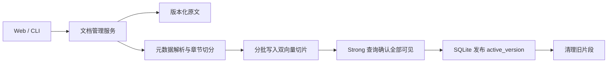
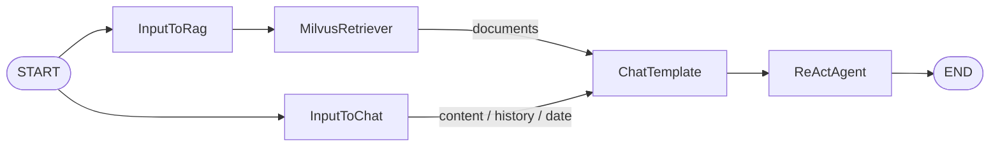

# 架构

[文档索引](README.md) · [配置](configuration.md) · [开发与测试](development.md)

OnCallAgent 将 HTTP 请求处理、业务服务、Agent 编排和外部客户端分开。客户端由入口创建并关闭，服务和图通过构造函数接收依赖，便于在本地使用脚本模型、HTTP/gRPC fixture 和内存存储验证同一执行路径。

## 模块与启动

```text
backend/
├── main.go                  # Web 依赖装配、图编译、路由与生命周期
├── cmd/                     # 独立 CLI
├── api/                     # GoFrame 请求与响应类型
├── internal/
│   ├── config/              # .env 加载、环境变量解析与校验
│   ├── controller/          # 提取请求、调用服务、转换响应
│   ├── service/             # 聊天、SSE、知识库、运维业务
│   └── ai/
│       ├── agent/           # 知识入库图、对话图、ADK 运维编排
│       ├── retriever/       # 共享检索适配
│       └── tools/           # 工具定义与注册
├── utility/
│   ├── client/              # 模型、Embedding、Milvus、Prometheus
│   ├── logger/              # 易读日志与关联信息
│   ├── mem/                 # 实例化的进程内会话记忆
│   └── middleware/          # 统一响应、HTTP 观测、上传限制
└── test/                    # 测试、fixture 与本地模拟
frontend/                    # 原生页面、开发代理与随附浏览器依赖
```

Web 启动时创建共享客户端、Store、SQLite 目录和检索服务，再注册工具并编译聊天与运维图。所有正常知识写入通过文档管理服务，初始化错误阻止启动。各 CLI 按操作选择依赖。

## 知识入库与版本发布



目录管理文档身份、元数据、active_version、latest_version 和入库状态；Milvus 是检索索引。Markdown front matter 与显式表单字段合并，术语尽量完整保留，SOP 按章节切分，超长块使用 UTF-8 安全窗口。标题、别名、告警名、章节和正文组成 search_text，供稠密向量与 BM25 共用。

版本指纹包含正文、规范化元数据、索引配置和切分参数。片段 ID 根据文档、版本和序号生成。分批写入不构成数据库间事务；SQLite 发布是可见性边界，检索会排除未发布和旧版本。旧片段清理失败记录 cleanup_pending，成功发布保持有效。

同进程同来源写入串行。Web 启动恢复中断尝试并重试清理；当前仅支持单写入者，不提供多进程锁。目录、原文及集合需要成对持久化和切换。

保留的 Eino KnowledgeIndexing 图契约为 document.Source → []string，用于旧结构兼容及 Dev 调试。v2 图直接执行只暂存片段；正常 Web 与 CLI 入库由 Manager 完成验证和发布，原图不能替代目录事务。CLI 复用 Loader 的根目录和符号链接检查。

## 存储与统一检索

| 字段 | 类型 | 用途 |
| --- | --- | --- |
| id | VARCHAR，非自动主键 | 稳定切片 ID |
| content / metadata | VARCHAR / JSON | 正文、来源、章节及版本信息 |
| document_id / version / chunk_index | VARCHAR / VARCHAR / INT64 | 文档关联及排序 |
| doc_type / domain / service | VARCHAR | 常用分类过滤 |
| search_text | VARCHAR，启用 jieba + lowercase | 带上下文的检索文本 |
| vector | FLOAT_VECTOR | HNSW/COSINE，M=16、efConstruction=128 |
| sparse_vector | SPARSE_FLOAT_VECTOR | Milvus BM25 Function 输出与稀疏倒排索引 |

SearchService 提供 dense、bm25 和 hybrid，通过 Eino Retriever 适配器服务聊天和内部文档工具，同时提供 HTTP 检索。hybrid 使用 Milvus 原生 RRF(k=60)。过滤作用于两路召回；返回前核对目录当前版本，候选不足时扩大召回。

Agent 默认 hybrid、TopK=3，页面默认 hybrid、TopK=10。COSINE 的 0.5 阈值仅适用于 dense；返回值标记 cosine、bm25 或 rrf，均不作为通用置信度。无命中返回空数组，依赖失败保留错误和取消语义。

init_knowledge 显式探测维度、检查或创建 v2 集合和双索引并加载。服务启动只校验，不自动重建。旧结构通过独立迁移命令写入目标集合，原文缺失时保留索引片段。详细约定见[知识库指南](knowledge.md)。

## 对话：RAG + ReAct ChatAgent



输入为 `*UserMessage{ID, Query, History}`，输出为 `*schema.Message`。History 由调用方传入，只接受普通 user/assistant 消息；执行时复制，不修改调用方数据。ChatTemplate 使用 `AllPredecessor` 等待两条分支完成。时间问题也会经过首轮检索。

提示词要求依据资料回答并引用来源；资料不足时可通过工具补充检索。文档和工具结果作为证据，不作为系统指令。首轮检索、模型和工具共用总预算；任一依赖失败会终止聊天。Invoke 与 Stream 每次执行状态独立。

Stream 先确认当前模型轮次是否包含工具调用，再转发最终回答片段，因此不保证逐 token 的首字延迟；不会把内部工具调用、推理或中间结果作为聊天正文输出。

### 会话与浏览器记录

HTTP ChatService 在 Agent 外管理记忆：按 `Id` 隔离，同 Id 的普通和流式请求串行，等待锁可取消；不同 Id 可并行。默认保存最近 3 轮完整 UserMessage/AssistantMessage，读取返回副本。

TTL 从最近成功提交开始计算，失败与读取不续期。普通请求完整成功后提交；SSE 正常结束且正文、消息和 done 均写出成功后提交。失败或取消不保存部分回答。该记忆只在当前进程内存在；CLI 不读取 HTTP 会话，需自行提供 History。

localStorage 仅保存浏览器展示记录，不会作为 History 发送到后端。恢复旧页面可能使用已失效的后端 Id；前端只能提示可能失效，不能检测服务重启。

## 运维分析：Plan / Execute / Replan


Planner 和 Replanner 共用规划模型；Executor 使用执行模型，每次处理一个计划步骤。Registry 复用时间、内部文档和可选 Prometheus 工具。默认最多 8 次 Executor/Replanner 循环，每次 Executor 最多 12 次模型生成，总预算 180 秒。

运维 Agent 为工具包装安全错误结果：认证、查询、格式错误或单工具超时可作为证据限制继续分析。父 context 取消、总超时、模型失败和执行上限会终止任务，保留已完成 detail。该策略不改变聊天 Agent 的失败行为。

只有 Replanner 有效 Respond 并结束任务才生成报告；报告固定包含告警、证据、根因候选、处理建议和未确认事项。detail 记录成对的步骤/工具生命周期、服务端耗时与受限的结构化证据，不保存思维链或完整日志正文。无告警不等于系统健康，缺少手册或禁用工具必须体现为限制。

HTTP 与 CLI 复用 AIOpsService：HTTP 执行固定任务，CLI 接受自定义 query；运维分析不写入聊天历史、localStorage 或后端会话。

`RunWithEvents` 为每次运行维护独立步骤 ID、父子关系和事件序号。Executor 在输入钩子开始，在 Replanner 获得 ExecutedSteps 时完成；assistant 消息本身不再代表步骤完成，避免框架重复输出造成重复条目。工具中间件独立记录每次调用的开始、结果及耗时。`CloneEvents` 深拷贝结构化证据，使回调、历史和最终响应互不影响。

`/api/ai_ops` 保留同步 JSON 契约；`/api/ai_ops_stream` 将同一服务的事件实时推送为 SSE，最终 done 包含完整报告与事件快照。运维与聊天共用支持写超时和 Flush 错误处理的串行写入器；运维流每 10 秒发送注释心跳，断连取消任务。前端按 stepId 合并展示，以浏览器单调时钟续显运行耗时，终态使用服务端 durationMs。不存在可重连的后台任务或持久化任务队列。

## Graph Schema 与扩展点

知识入库与聊天的 `workflow.json` 位于各自 [agent 子目录](../backend/internal/ai/agent/)。它们是与运行代码一致的 Graph Schema，不标称可视化编辑器导出文件；编排初稿由 Eino Dev 代码生成工具生成，再补齐依赖注入和执行边界。

修改图时需同步维护 Schema 和 Compile 回调测试，尤其是节点 ID、边、输入输出类型及 `documents` 映射。新增工具应放入 Registry 并接收已有客户端；不要在工具或图内建立全局连接。
