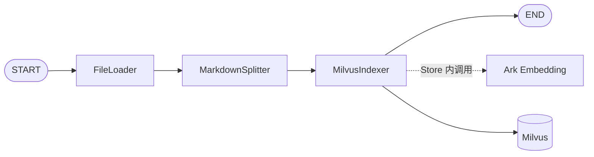
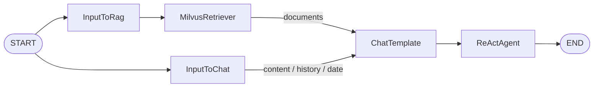

# 架构

[文档索引](README.md) · [配置](configuration.md) · [开发与测试](development.md)

OnCallAgent 将 HTTP 请求处理、业务服务、Agent 编排和外部客户端分开。客户端由入口创建并关闭，服务和图通过构造函数接收依赖，便于在本地使用脚本模型、HTTP/gRPC fixture 和内存存储验证同一执行路径。

## 模块与启动

```text
backend/
├── main.go                  # Web 依赖装配、图编译、路由与生命周期
├── cmd/                     # 独立 CLI
├── api/                     # GoFrame 请求与响应类型
├── internal/
│   ├── config/              # .env 加载、环境变量解析与校验
│   ├── controller/          # 提取请求、调用服务、转换响应
│   ├── service/             # 聊天、SSE、知识库、运维业务
│   └── ai/
│       ├── agent/           # 知识入库图、对话图、ADK 运维编排
│       ├── retriever/       # 共享检索适配
│       └── tools/           # 工具定义与注册
├── utility/
│   ├── client/              # 模型、Embedding、Milvus、Prometheus
│   ├── logger/              # 易读日志与关联信息
│   ├── mem/                 # 实例化的进程内会话记忆
│   └── middleware/          # 统一响应、HTTP 观测、上传限制
└── test/                    # 测试、fixture 与本地模拟
frontend/                    # 原生页面、开发代理与随附浏览器依赖
```

Web 启动顺序为配置加载 → 创建共享客户端与 Store → 注册工具 → 构造运维 Agent → 编译聊天图与入库图 → 构造服务 → 注册路由并监听。初始化错误会阻止启动；请求中不创建客户端或重新编译图。各 CLI 根据实际操作选择所需依赖。

## 知识入库：KnowledgeIndexing



图契约为 `document.Source → []string`，返回写入片段的 ID。Embedding 属于 Indexer/Store 内部能力，不是独立图节点。

| 节点 | 行为 |
| --- | --- |
| FileLoader | 从来源根目录读取常规 UTF-8 txt/md/markdown 文件，校验路径、格式、大小和内容 |
| MarkdownSplitter | 按配置的字节大小与重叠切分，识别 Markdown 标题，生成稳定 ID 和元数据 |
| MilvusIndexer | 分批 Upsert、检查返回 ID，全部批次确认后清理同文档旧版本 |

HTTP 上传先由 KnowledgeService 校验文本并原子保存 hash 命名的版本文件，再以真实路径构造 `document.Source` 调用图。逻辑来源采用原始规范化文件名，通过定向 LoaderOption 传给 FileLoader；它不改变物理路径和根目录检查。CLI 默认以相对 `--root` 的规范化路径作为来源。

片段保留 `source`、`title`、`chunk_index`、`content_hash`、`document_id`、`version` 等元数据。相同来源、内容及切分配置生成相同片段 ID；幂等性以可见主键集合判断，不依赖数据库物理行数。

同一进程内同来源写入串行；上传锁覆盖保存与图调用，Indexer 使用独立写入锁。写入失败会保留版本文件和旧向量；重试可用相同 ID 收敛。分批写入不是跨批事务，失败时可能已存在部分新版本片段；只保证全部新片段确认后才清理旧版本。锁不提供跨进程协调。

## 向量存储与检索

| 字段 | 类型 | 用途 |
| --- | --- | --- |
| `id` | VARCHAR(256)，非自动主键 | 稳定片段 ID |
| `content` | VARCHAR(65535) | 文档正文 |
| `metadata` | JSON | 来源、标题、序号、版本等 |
| `vector` | FLOAT_VECTOR | 与实际 Embedding 输出相同维度 |

初始化使用 HNSW/COSINE（M=16、efConstruction=128）；存取复用同一 Embedding 模型、数值向量转换和 COSINE 度量，检索采用 Strong 一致性。向量必须维度一致、可转换为有限 float32 且非零。

Retriever 默认 TopK=3、阈值 0.5，按分数降序返回正文、来源、标题、ID 和 score；无命中返回空数组，查询失败返回错误。阈值需结合自己的模型和语料调整，不能视为通用置信度。

`init_knowledge` 显式探测维度、检查或创建集合与索引并加载。Web、检索与 Agent CLI 只使用已有集合，不隐式初始化或加载。已有结构不匹配时报告差异，保留数据。

## 对话：RAG + ReAct ChatAgent



输入为 `*UserMessage{ID, Query, History}`，输出为 `*schema.Message`。History 由调用方传入，只接受普通 user/assistant 消息；执行时复制，不修改调用方数据。ChatTemplate 使用 `AllPredecessor` 等待两条分支完成。时间问题也会经过首轮检索。

提示词要求依据资料回答并引用来源；资料不足时可通过工具补充检索。文档和工具结果作为证据，不作为系统指令。首轮检索、模型和工具共用总预算；任一依赖失败会终止聊天。Invoke 与 Stream 每次执行状态独立。

Stream 先确认当前模型轮次是否包含工具调用，再转发最终回答片段，因此不保证逐 token 的首字延迟；不会把内部工具调用、推理或中间结果作为聊天正文输出。

### 会话与浏览器记录

HTTP ChatService 在 Agent 外管理记忆：按 `Id` 隔离，同 Id 的普通和流式请求串行，等待锁可取消；不同 Id 可并行。默认保存最近 3 轮完整 UserMessage/AssistantMessage，读取返回副本。

TTL 从最近成功提交开始计算，失败与读取不续期。普通请求完整成功后提交；SSE 正常结束且正文、消息和 done 均写出成功后提交。失败或取消不保存部分回答。该记忆只在当前进程内存在；CLI 不读取 HTTP 会话，需自行提供 History。

localStorage 仅保存浏览器展示记录，不会作为 History 发送到后端。恢复旧页面可能使用已失效的后端 Id；前端只能提示可能失效，不能检测服务重启。

## 运维分析：Plan / Execute / Replan


Planner 和 Replanner 共用规划模型；Executor 使用执行模型，每次处理一个计划步骤。Registry 复用时间、内部文档和可选 Prometheus 工具。默认最多 8 次 Executor/Replanner 循环，每次 Executor 最多 12 次模型生成，总预算 180 秒。

运维 Agent 为工具包装安全错误结果：认证、查询、格式错误或单工具超时可作为证据限制继续分析。父 context 取消、总超时、模型失败和执行上限会终止任务，保留已完成 detail。该策略不改变聊天 Agent 的失败行为。

只有 Replanner 有效 Respond 并结束任务才生成报告；报告固定包含告警、证据、根因候选、处理建议和未确认事项。detail 记录事件和工具结果概要，不保存思维链或完整日志正文。无告警不等于系统健康，缺少手册或禁用工具必须体现为限制。

HTTP 与 CLI 复用 AIOpsService：HTTP 执行固定任务，CLI 接受自定义 query；运维分析不写入聊天历史、localStorage 或后端会话。

## Graph Schema 与扩展点

知识入库与聊天的 `workflow.json` 位于各自 [agent 子目录](../backend/internal/ai/agent/)。它们是与运行代码一致的 Graph Schema，不标称可视化编辑器导出文件；编排初稿由 Eino Dev 代码生成工具生成，再补齐依赖注入和执行边界。

修改图时需同步维护 Schema 和 Compile 回调测试，尤其是节点 ID、边、输入输出类型及 `documents` 映射。新增工具应放入 Registry 并接收已有客户端；不要在工具或图内建立全局连接。
