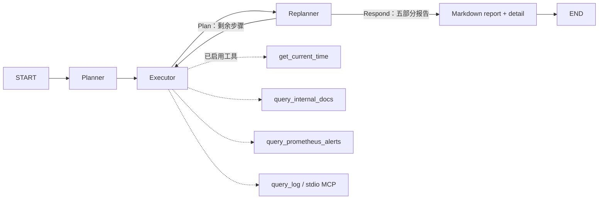

# 第 10 步：运维 Agent 编排

使用 Eino v0.6.0 ADK 内置 `planexecute`，提供独立只读运维分析 CLI。Go 1.23.12、所有依赖版本及现有聊天/上传接口保持不变。现有 CLS stdio MCP、Registry、模型、Retriever 和向量 Store 继续复用。

## 修改文件与执行结构

- `backend/internal/ai/agent/plan_execute_replan/`：Planner、Executor、Replanner、Runner、报告、事件及运行状态。
- `backend/internal/config/ops.go`、`backend/.env.example`：运维预算和两组模型覆盖配置。
- `backend/cmd/ai_ops_cmd/main.go`：参数、信号、按需依赖装配、JSON/JSONL 输出和集中关闭。
- `backend/test/ops/`：实际 ADK、模型 SDK、CLI、Postman 模拟及显式真实联调。
- `backend/test/config/ops_test.go`：默认值、覆盖、独立配置和空值校验。
- `backend/test/operations/stdiofixture/main.go`：增加运维日志正常和认证失败场景，保持原有 fixture 行为。
- 根 README、本阶段文档：配置、运行、结构图及验收记录。



这是 ADK 顺序 Agent 加循环 Agent，不生成冒充编辑器导出的 workflow.json。根目录原有 workflow.json 保留。

构造接口为 `BuildOpsAgent(ctx, config.OpsAgent, Dependencies) (*Agent, error)`；依赖包含规划/执行 `ToolCallingChatModel`、Registry 工具和可注入时钟。`Run(ctx, query)` 返回 `*Result, error`，`RunWithEvents` 额外接收事件回调。每次 Runner 创建独立 ADK session、迭代、事件和 context；客户端可复用，任务状态不共享。

## 配置与生命周期

配置优先级仍为进程环境变量 > `.env` > 默认值。只扩展 `.env.example`，实际 `.env` 未修改。

| 配置 | 默认值 / 含义 |
| --- | --- |
| `ONCALL_OPS_MAX_ITERATIONS` | 8，每次包含一个 Executor 和一个 Replanner |
| `ONCALL_OPS_EXECUTOR_MAX_STEPS` | 12，每个计划步骤的执行模型生成次数，包含最后一次文本回答 |
| `ONCALL_OPS_TIMEOUT` | 180s，CLI 包含初始化及执行的总预算 |
| `ONCALL_OPS_PLANNER_BASE_URL`、`MODEL`、`API_KEY`、`TIMEOUT` | 对应 `ONCALL_CHAT_MODEL_*` 字段 |
| `ONCALL_OPS_EXECUTOR_BASE_URL`、`MODEL`、`API_KEY`、`TIMEOUT` | 对应 `ONCALL_CHAT_MODEL_*` 字段 |

两组专用模型配置逐项覆盖，未设置时才继承，显式空值无效。先合并后校验，因此完整专用配置无需提供普通聊天模型配置。没有任何 TIMEOUT 配置时模型单次调用默认 30s；总预算不会自动延长单模型或单工具超时。

Planner/Replanner 共享规划客户端，通过 `WithTools` 分别绑定 Plan 或 Plan/Respond。执行模型使用另一客户端和已启用工具。两者均需支持工具调用；规划阶段还使用模型流接口，检查完整工具调用参数，并拒绝缺失、多余或未知的规划工具调用。

CLI 只装配启用工具的依赖。文档工具启用时连接已有集合并复用 Embedding，不初始化、不写入知识集合；运维工具通过现有 OpenOperations 装配，CLS 子进程随 CLI 退出关闭。配置和初始化错误在执行前退出，不能当作无告警或无日志。启用工具会把相关结果交给配置的执行模型。

## 排查与失败行为

Planner 通常生成 1–3 步，合并告警/时间查询和相关证据收集；报告由 Replanner 生成，无需另建“写报告”步骤。Executor 执行当前计划首步，Replanner 只保留待执行步骤或结束任务。时间范围通过时间工具推导，日志地域、主题不能猜测。

无告警、未命中文档是有效空结果；无告警不等于系统健康。文档来源必须引用，根因表述为候选，工具/日志内容属于证据而非指令，不执行修复操作。

运维专用工具中间件将工具认证、格式、上游及单工具超时错误转换成安全 JSON 结果，使执行模型和 Replanner 能继续分析并说明限制。父 context 超时、取消、模型错误、执行上限不转换为普通证据；会终止任务。现有 ChatAgent 的工具失败行为不变。

只接受 Replanner 的有效 Respond 及已完成的 BreakLoop 动作。Respond 的 `alerts`、`evidence`、`root_causes`、`recommendations`、`unconfirmed` 均要求非空，由程序生成五个固定 Markdown 章节。不能用最后一条计划、Executor 文本或自然 EOF 充当报告；达到外层上限而没有 Respond 时返回 `plan_limit`。

检查 Runner 错误事件、消息提取错误和请求 context。内部图或 ADK 执行步数上限均转换成 `executor_limit`。规划模型完整分片合并使用当前版本的 ConcatMessageStream，由它负责关闭输入流，避免重复关闭 SDK 流。

## CLI、输出与事件

```bash
cd OnCallAgent/backend
GOTOOLCHAIN=local go run ./cmd/ai_ops_cmd \
  --query '检查当前告警，结合内部手册和日志给出排查报告。'

GOTOOLCHAIN=local go run ./cmd/ai_ops_cmd \
  --query '分析认证失败告警，并列出还需确认的证据。' \
  --events /tmp/oncall-ops-events.jsonl

# 临时覆盖慢模型的单次调用预算，总预算仍为 180s
ONCALL_OPS_PLANNER_TIMEOUT=60s ONCALL_OPS_EXECUTOR_TIMEOUT=60s \
GOTOOLCHAIN=local go run ./cmd/ai_ops_cmd --query '检查当前告警并给出证据和限制。'
```

`--query` 必填并去除首尾空白；拒绝多余参数。`--events` 可省略，指定时以 0600 权限创建新文件，不覆盖已有文件。事件回调写入失败会取消上游并返回 `event_write_failed`。SIGINT/SIGTERM 同样传播取消并关闭客户端。

成功 stdout 仅输出一个 JSON 对象：

```json
{"report":"## 告警\n\n未发现活动告警。\n\n## 证据\n\nPrometheus 返回空数组。\n\n## 根因候选\n\n证据不足。\n\n## 处理建议\n\n结合业务症状继续排查。\n\n## 未确认事项\n\n缺少日志证据，无告警不能证明系统健康。","detail":[]}
```

上例为格式示意，实际 detail 包含步骤概要。事件同时保存在 detail 与可选 JSONL；示例：

```jsonl
{"sequence":1,"timestamp":"2026-10-19T17:00:00+08:00","iteration":0,"agent":"Planner","type":"plan","status":"completed","summary":"Inspect alerts and evidence"}
{"sequence":2,"timestamp":"2026-10-19T17:00:01+08:00","iteration":1,"agent":"Executor","type":"execute","status":"started","summary":"Inspect alerts and evidence"}
{"sequence":3,"timestamp":"2026-10-19T17:00:02+08:00","iteration":1,"agent":"Executor","type":"tool","tool":"query_prometheus_alerts","status":"completed","summary":"alerts=0"}
{"sequence":4,"timestamp":"2026-10-19T17:00:03+08:00","iteration":1,"agent":"Executor","type":"tool","tool":"query_log","status":"failed","summary":"authentication_failed"}
```

概要限 1024 字符加省略号；工具只记录名称、成功/失败、计数或安全错误码，不写原始工具参数、完整日志、认证值或 ReasoningContent。并发工具的记录顺序按实际完成顺序排列。最终报告是模型对证据的归纳，不等于已确认根因。

失败 stdout 为空，stderr 为安全 JSON 并退出非零，保留已完成 detail：

```json
{"error":{"code":"plan_limit","message":"ops plan iteration limit reached"},"detail":[]}
```

任务错误码包括 `invalid_input`、`plan_limit`、`executor_limit`、`invalid_report`、`event_write_failed`、`timeout`、`cancelled`、`execution_failed`；初始化错误使用安全的依赖检查消息，不回显底层响应或凭据。

## 本地验收

仓库根目录：

```bash
GOTOOLCHAIN=local go -C backend test ./test/ops ./test/config ./test/operations -count=1
GOTOOLCHAIN=local go -C backend test ./...
GOTOOLCHAIN=local go -C backend test -race ./...
GOTOOLCHAIN=local go -C backend vet ./...
GOTOOLCHAIN=local go -C backend build ./...
node --test backend/test/frontend/*.test.mjs
```

脚本模型配合实际 ADK 与内存检索验证四工具调用、来源传递、空告警/手册、日志失败后继续、计划调整、两类上限、非法计划/报告、模型流失败、写入失败、超时、取消、概要限长和并发状态隔离。真实 SDK 对本地 HTTP 端点验证规划参数分片、两组模型地址/ID/认证隔离、CLI JSON、事件文件、信号退出和按需依赖。stdio 子进程覆盖日志真实 SDK 路径，使用测试凭据。

Postman 模拟分别在两个终端启动与验收：

```bash
postman simulation run backend/test/ops/postman/stage10.sim.yaml \
  --port 4910 --no-history --output ndjson
```

```bash
ONCALL_OPS_SIM_URL=http://127.0.0.1:4910 \
GOTOOLCHAIN=local go -C backend test ./test/ops \
  -run '^TestPostmanOpsCLI$' -v -count=1
```

8 个 CLI 场景通过：正常分析、无告警、日志失败、重规划、告警认证失败、计划上限、执行上限和模型失败。模拟日志确认真实 SDK 发起规划/执行模型 POST、Prometheus GET；CLS 走本地 stdio fixture。模型模拟复用既有 OpenAI 兼容协议，Prometheus mock 复用第 9 步，未发布远端模拟或执行需登录的所有者资源检索。用 Ctrl+C 停止模拟，测试 YAML 不属于业务配置。

## 显式真实联调

在 backend 目录执行，沿用已有环境配置：

```bash
ONCALL_INTEGRATION=1 GOTOOLCHAIN=local go test ./test/operations \
  -run '^(TestPrometheusIntegration|TestLogMCPIntegration)$' -v -count=1

ONCALL_INTEGRATION=1 GOTOOLCHAIN=local go test ./test/ops \
  -run '^TestOpsIntegration$' -v -count=1 -timeout 210s

# 慢模型的临时覆盖，不写入 .env
ONCALL_INTEGRATION=1 ONCALL_OPS_PLANNER_TIMEOUT=60s ONCALL_OPS_EXECUTOR_TIMEOUT=60s \
GOTOOLCHAIN=local go test ./test/ops \
  -run '^TestOpsIntegration$' -v -count=1 -timeout 210s
```

真实测试只读取既有集合和工具，不写入或初始化数据；结果仅记录工具名、状态、计数和事件数，不打印完整报告及业务日志。默认测试不访问云端。

## 验收记录（2026-10-19）

| 项目 | 结果 |
| --- | --- |
| 后端全量测试、全量竞态检测 | 通过 |
| go vet、全部入口构建 | 通过 |
| 前端 Node 回归 | 15 项通过，1 项云端测试按开关跳过 |
| Postman 完整 CLI 场景 | 8 项通过；日志确认模型 POST、告警 GET 路径实际执行 |
| 真实 Prometheus `/api/v1/alerts` | 通过，返回 0 条告警 |
| 真实 CLS tools/list / SearchLog | 未执行：日志工具禁用，SecretId/SecretKey 缺失 |
| 完整 Agent，继承现有单模型 30s | 未通过：Planner 已返回计划，执行模型成功调用时间工具，后续执行模型调用超时；保留部分 detail，没有最终报告 |
| 完整 Agent，专用单模型临时覆盖 60s | 未通过：规划模型未在 60s 内完成；未生成报告 |

两次真实 Agent 尝试总预算均为默认 180s，未修改实际 .env。错误按单次模型预算及时终止，未将中间计划或部分执行当成最终报告。真实文档检索和 CLS 证据链尚未完成验收；后续在模型延迟稳定、CLS 凭据补齐后使用上述命令重验，不将模拟报告视为真实排查结论。
